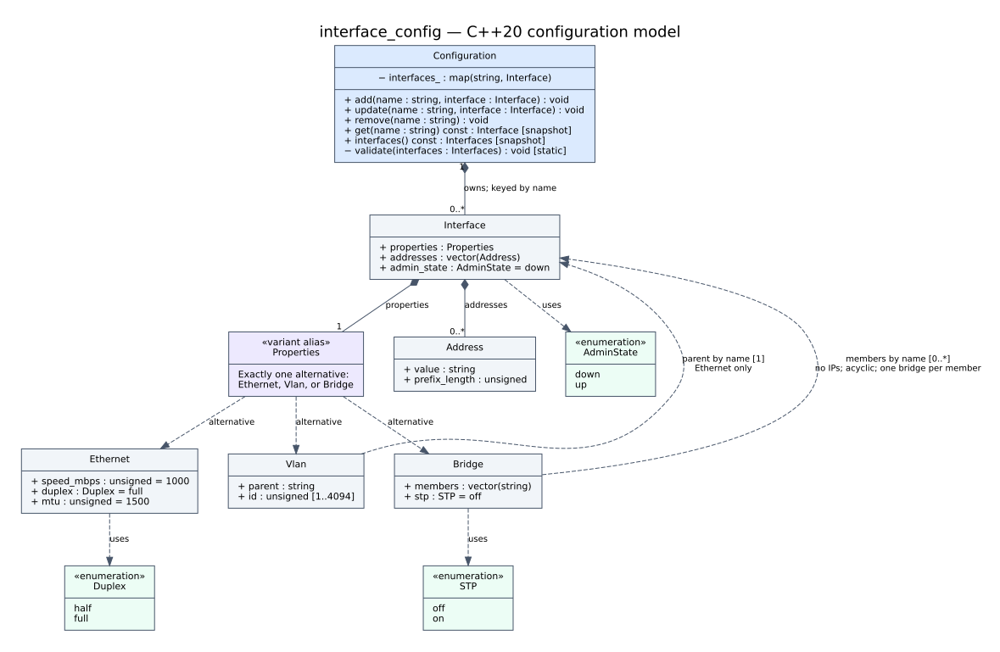

# InterfaceConfigAPI

C++20 in-memory desired-state model for a Linux gateway. Supports Ethernet,
VLANs, bridges, IPv4/IPv6 prefixes, and administrative state. No daemon,
netlink/ioctl backend, JSON, or thread synchronization is included.

## Build and run

Requires Linux, a C++20 compiler, CMake 3.20+, and Make. No external libraries.

```sh
make build  # Configure and build Debug (also the default for plain make)
make debug  # Configure and build Debug, then run the example
make run    # Configure and build Release, then run the example
make test   # Configure and build Debug, then run tests
```

Run these commands from the repository root. The Makefile wraps the existing
CMake presets; build outputs go to `build/debug` and `build/release`.

## API and design



Filled diamonds indicate composition; dashed arrows indicate type usage,
variant alternatives, or references resolved by interface name. The variant
alternatives use value types rather than inheritance.
[Diagram source](docs/diagrams/configuration-uml.dot) (regenerate with
`dot -Tsvg docs/diagrams/configuration-uml.dot -o docs/diagrams/configuration-uml.svg`).

[Public header](include/interface_config/configuration.hpp),
[implementation](src/configuration.cpp), and [example](examples/main.cpp).

`Configuration` owns a map keyed by stable interface names. `Interface` holds
shared properties and a `std::variant` of Ethernet, VLAN, or Bridge properties.
References use names rather than pointers, so copies remain self-contained.
`get()` returns an editable snapshot; change it and pass it to `update()`.
`interfaces()` returns an owned snapshot for enumeration. Editing the snapshot
does not affect the configuration; it remains valid after later mutations or
destruction of the configuration.

`add()` and `update()` construct a private candidate, check all local and graph
constraints, then commit with a nonthrowing swap. Validation is internal to each
mutation: callers never need a separate validation pass, and no invalid state
becomes observable. Failures, including allocation failures, leave the original
configuration unchanged. Scanning and copying a few hundred interfaces favors
clarity over indexes and rollback machinery. `remove()` checks inbound references
before erasing. Mutation errors throw `std::invalid_argument`; missing `get()`
throws `std::out_of_range`. Diagnostic messages identify the violated rule.

Updates replace the complete interface value and can change its type only when
all dependencies remain valid. VLAN parents must exist and be Ethernet; bridge
members must exist and have no addresses. The same checks apply when updating
parents or adding addresses to existing members. Dependents must be removed or
explicitly detached/reparented before removing their dependencies.

Additional model policies (beyond the assignment):

- Names must be nonempty and contain no NUL; renaming is intentionally absent.
- Bridge members are unique and can belong to at most one bridge. Nested bridges
  are allowed, with self-membership and dependency cycles rejected.
- Ethernet speed is a positive Mbps integer; MTU is 68–65535. These are model
  bounds, not hardware capability checks. Duplex, admin, and STP enum values are checked. Bridge STP uses `STP::on` or
  `STP::off` (the default).
- Linux `inet_pton` validates address text, with IPv4 prefixes 0–32 and IPv6
  prefixes 0–128. Host bits are retained. CIDR suffixes and zone identifiers are
  not accepted in address text; the prefix is supplied separately.
- An IP address cannot belong to two interfaces, regardless of prefix length or
  textual spelling. Uniqueness compares parsed bytes within each address family;
  IPv4 and IPv4-mapped IPv6 are distinct. Repeated addresses on the same interface
  are also rejected. Updating or removing an owner releases its old addresses.
- VLAN parent/ID pairs must be unique across interfaces. The same ID may be used
  on different Ethernet parents. Updating or removing a VLAN releases its old pair.

A polymorphic hierarchy was considered, but a variant makes the supported
interface types explicit and provides ordinary value copying, avoiding the
pointers and virtual cloning typically needed for an inheritance-based model.
Per-property setters were also considered; whole-value updates allow several
related fields to change together without intermediate states. Mutable pointers
into stored interfaces are deliberately unavailable.

## Adding Bond/LAG

- [ ] Add a `Bond` value type with members and bonding mode to `Properties`.
- [ ] Extend the internal dependency helper to return Bond members so the generic
  cycle check and removal protection cover its dependencies.
- [ ] Add validation for member existence, exclusivity, address rules, and allowed
  member types.
- [ ] Add examples and tests for creation, updates, type changes, and teardown.

No ownership or mutation API changes are needed.

- [ ] Optional future extension: add a batch transaction for atomic changes to
  multiple interfaces using the same candidate-and-commit mechanism.

Current test coverage:

- [x] Invalid insertions and updates.
- [x] Unchanged state after rejection.
- [x] Address boundaries.
- [x] Dependency removal.
- [x] Bridge membership and dependency cycles.
- [x] Detached snapshots.
- [x] Reparenting and successful teardown.
- [x] Checks remain enabled in Release.
